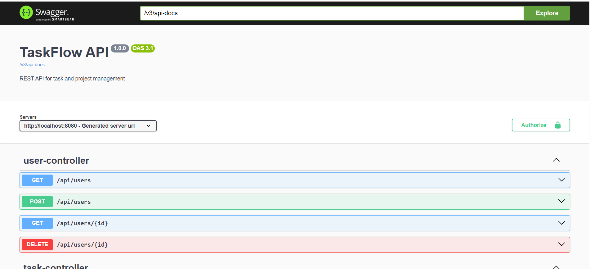

# TaskFlow

**TaskFlow** — RESTful backend-приложение для управления проектами и задачами.

Приложение предоставляет регистрацию и аутентификацию пользователей, разграничение доступа по ролям, управление проектами и задачами с защитой пользовательских данных.

**English version:** [Read in English](#english)

---

# Русский

## О проекте

TaskFlow — backend-приложение, разработанное для организации проектов и управления задачами. Проект демонстрирует применение Spring Boot, REST API, реляционной базы данных, JWT-аутентификации и принципов разделения ответственности между слоями приложения.

## Технологический стек

- Java 21
- Spring Boot 4
- Spring Web MVC
- Spring Data JPA / Hibernate
- PostgreSQL 16
- Spring Security
- JWT (JSON Web Token)
- Flyway
- Maven
- Swagger / OpenAPI
- JUnit 5
- Mockito

## Возможности

- Регистрация пользователей
- Аутентификация с использованием JWT
- Разграничение доступа по ролям USER и ADMIN
- Создание, просмотр, изменение и удаление проектов
- Создание, просмотр, изменение и удаление задач
- Связь задач с проектами
- Назначение задач пользователям
- Защита проектов и задач от доступа посторонних пользователей
- Автоматическое управление миграциями базы данных через Flyway
- Документация REST API через Swagger UI
- Модульные и интеграционные тесты

## Требования

Для запуска проекта необходимы:

- Java 21
- Docker и Docker Compose
- Git

**Статус тестирования платформ:**

На данный момент запуск и работа приложения проверены на Windows 11 с использованием PowerShell. Инструкции для Linux и macOS предоставлены, но пока не протестированы на этих платформах.

## Установка и запуск

### 1. Клонирование репозитория

```bash
git clone https://github.com/ai-programmer7/taskflow.git
cd taskflow
```

### 2. Запуск PostgreSQL

Запусти базу данных через Docker Compose:

```bash
docker compose up -d
```

Проверить состояние контейнера можно командой:

```bash
docker compose ps
```

### 3. Настройка переменных окружения

Перед запуском приложения необходимо установить переменную `JWT_SECRET`.

**Windows (PowerShell):**

```powershell
$env:JWT_SECRET = "your-long-secret-key"
```

**Linux:**

```bash
export JWT_SECRET="your-long-secret-key"
```

**macOS:**

```bash
export JWT_SECRET="your-long-secret-key"
```

Используй собственный секретный ключ достаточной длины. Не добавляй реальные секреты и токены в Git.

Переменную необходимо установить в том же терминале, из которого запускается приложение.

### 4. Запуск приложения

**Windows (PowerShell):**

```powershell
.\mvnw.cmd spring-boot:run
```

**Linux / macOS:**

```bash
chmod +x mvnw
./mvnw spring-boot:run
```

Spring Boot подключится к PostgreSQL, а Flyway автоматически применит миграции базы данных.

После успешного запуска приложение будет доступно по адресу:

http://localhost:8080

### 5. Swagger UI

Документация REST API доступна по адресу:

http://localhost:8080/swagger-ui.html

Через Swagger UI можно просматривать эндпоинты, изучать параметры запросов и отправлять HTTP-запросы.

## Примеры использования API



Все защищённые эндпоинты требуют JWT-токен в заголовке `Authorization`.

### 1. Регистрация пользователя

`POST /api/users`

```json
{
  "username": "john",
  "email": "john@example.com",
  "password": "Password123"
}
```

### 2. Авторизация

`POST /api/auth/login`

```json
{
  "username": "john",
  "password": "Password123"
}
```

В ответ приложение возвращает JWT-токен.

Для доступа к защищённым эндпоинтам передавай его в заголовке:

```http
Authorization: Bearer <your-jwt-token>
```

### 3. Создание проекта

`POST /api/projects`

```json
{
  "name": "My First Project",
  "description": "Project description",
  "status": "ACTIVE"
}
```

Владелец проекта определяется автоматически на основе авторизованного пользователя.

### 4. Создание задачи

`POST /api/tasks`

```json
{
  "title": "Implement authentication",
  "description": "Add JWT authentication",
  "status": "TODO",
  "priority": "HIGH",
  "projectId": 1
}
```

Задача создаётся внутри проекта, принадлежащего авторизованному пользователю. Значение `projectId` должно соответствовать ID существующего проекта.

## Тестирование

Для запуска тестов используй Maven Wrapper.

**Windows (PowerShell):**

```powershell
.\mvnw.cmd clean verify
```

**Linux / macOS:**

```bash
./mvnw clean verify
```

Команда выполняет сборку проекта и запуск тестов.

---

# English

## About

TaskFlow is a RESTful backend application designed for project organization and task management.

The application demonstrates the use of Spring Boot, REST APIs, relational databases, JWT authentication, and layered application architecture.

## Tech Stack

- Java 21
- Spring Boot 4
- Spring Web MVC
- Spring Data JPA / Hibernate
- PostgreSQL 16
- Spring Security
- JWT (JSON Web Token)
- Flyway
- Maven
- Swagger / OpenAPI
- JUnit 5
- Mockito

## Features

- User registration
- JWT-based authentication
- Role-based access control (USER and ADMIN)
- Project creation, retrieval, updating, and deletion
- Task creation, retrieval, updating, and deletion
- Task-to-project relationships
- Task assignment to users
- Protection against unauthorized access to other users' projects and tasks
- Automatic database schema migrations with Flyway
- REST API documentation with Swagger UI
- Unit and integration tests

## Requirements

The following tools are required:

- Java 21
- Docker and Docker Compose
- Git

**Platform testing status:**

Application startup and functionality have been tested on Windows 11 using PowerShell. Instructions for Linux and macOS are provided but have not yet been tested on these platforms.

## Installation and Setup

### 1. Clone the repository

```bash
git clone https://github.com/ai-programmer7/taskflow.git
cd taskflow
```

### 2. Start PostgreSQL

Start the database using Docker Compose:

```bash
docker compose up -d
```

Check the container status:

```bash
docker compose ps
```

### 3. Configure environment variables

Before starting the application, set the `JWT_SECRET` environment variable.

**Windows (PowerShell):**

```powershell
$env:JWT_SECRET = "your-long-secret-key"
```

**Linux:**

```bash
export JWT_SECRET="your-long-secret-key"
```

**macOS:**

```bash
export JWT_SECRET="your-long-secret-key"
```

Use your own sufficiently long secret key. Never commit real secrets or tokens to Git.

The environment variable must be set in the same terminal session used to run the application.

### 4. Run the application

**Windows (PowerShell):**

```powershell
.\mvnw.cmd spring-boot:run
```

**Linux / macOS:**

```bash
chmod +x mvnw
./mvnw spring-boot:run
```

Spring Boot will connect to PostgreSQL, and Flyway will automatically apply database migrations.

Once started, the application will be available at:

http://localhost:8080

### 5. Swagger UI

API documentation is available at:

http://localhost:8080/swagger-ui.html

Swagger UI allows you to explore API endpoints, inspect request parameters, and send HTTP requests.

## API Usage Examples


All protected endpoints require a JWT token in the `Authorization` header.

### 1. User Registration

`POST /api/users`

```json
{
  "username": "john",
  "email": "john@example.com",
  "password": "Password123"
}
```

### 2. Authentication

`POST /api/auth/login`

```json
{
  "username": "john",
  "password": "Password123"
}
```

The application returns a JWT token.

Include it in the request header when accessing protected endpoints:

```http
Authorization: Bearer <your-jwt-token>
```

### 3. Create a Project

`POST /api/projects`

```json
{
  "name": "My First Project",
  "description": "Project description",
  "status": "ACTIVE"
}
```

The project owner is automatically determined from the authenticated user.

### 4. Create a Task

`POST /api/tasks`

```json
{
  "title": "Implement authentication",
  "description": "Add JWT authentication",
  "status": "TODO",
  "priority": "HIGH",
  "projectId": 1
}
```

The task is created inside a project owned by the authenticated user. The `projectId` must refer to an existing project.

## Testing

To build the project and run the tests, use Maven Wrapper.

**Windows (PowerShell):**

```powershell
.\mvnw.cmd clean verify
```

**Linux / macOS:**

```bash
./mvnw clean verify
```

This command builds the application and executes the test suite.